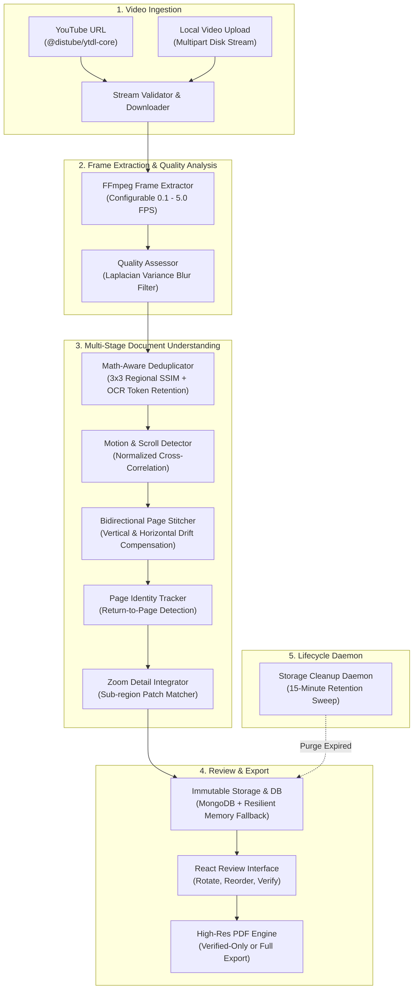

# Video2PDF

> High-throughput, CPU-optimized computer vision pipeline and document reconstruction engine that extracts clean, print-ready PDF notes from lecture videos, handwritten notebooks, and presentation recordings.

---

## Overview

Educational lectures recorded from desk cameras, digital slides, or screen shares pose unique computer vision challenges:
- **Notebook Paper Ruling:** Consecutive pages on lined paper yield visual structural similarity (SSIM) > 0.85 despite containing completely different notes.
- **Continuous Scrolling & Panning:** Digital documents and PDF readers scroll both downwards and upwards with camera jitter and horizontal panning.
- **Equation Additions & Zoom Detail:** Instructors write incremental math symbols or zoom in on specific derivations, requiring localized detail integration without duplicate page emissions.
- **Page Returns:** Lecturers frequently flip back to earlier slides to reference prior definitions before continuing forward.

Video2PDF solves these challenges without requiring expensive GPU infrastructure. Running entirely on standard multi-core CPUs (e.g., Intel Core i3 or containerized cloud instances), it extracts, deduplicates, aligns, stitches, and compiles lecture notes into high-resolution PDF documents.

---

## System Architecture



---

## Core Technical Features

### 1. Math-Aware Frame Deduplication
Naive perceptual hashing discards handwritten mathematical equations when additions occupy a small fraction of the frame. Video2PDF evaluates content changes through a dual-criterion strategy:
- **3x3 Regional Structural Similarity (SSIM):** Decomposes the frame into 9 spatial quadrants to catch isolated handwritten derivations even when global SSIM exceeds 0.98.
- **Token Retention Ratio:** On lined notebook paper where background lines inflate visual correlation, the pipeline performs OCR word-boundary analysis ($|\text{words}_A \cap \text{words}_B| / |\text{words}_A|$). If token retention drops below 40%, the system correctly detects a physical page turn rather than an in-place addition.

### 2. Bidirectional Scrolling & Panning Alignment
Digital slide readers and tablet drawing apps frequently scroll both down and up. The alignment algorithm computes the 2D cross-correlation surface between successive frames to determine vertical shift ($\Delta y$) and horizontal drift ($\Delta x$):
- **Downward Scrolling ($\Delta y > 0$):** Automatically aligns overlapping regions and appends freshly revealed content.
- **Upward Scrolling ($\Delta y < 0$):** Correctly prepends or reconciles retrograded viewing windows without duplicating overlapping text blocks.
- **Ambiguity Ratio Validation:** Rejects repetitive text patterns where multi-peak correlation surfaces indicate ambiguous alignment.

### 3. Return-to-Previous-Page Identity Tracking
When an instructor flips backward to slide 2 to answer a question before returning to slide 5, conventional chronological extractors create redundant duplicate pages. Video2PDF tracks persistent logical page identities (`pageIdentityId`). Returning to a previous page associates new observations with the original logical page record, preserving chronological integrity.

### 4. Non-Destructive Provenance & Review Statuses
- Extracted source frames are preserved as immutable evidence on disk.
- Pages maintain full provenance references (`sourceFrameIds: string[]`).
- The pipeline assigns explicit confidence statuses (`VERIFIED` vs `NEEDS_REVIEW`) along with descriptive warning strings (`POSSIBLE_OCCLUSION`, `UNCERTAIN_SCROLL_ALIGNMENT`, `LOW_CONFIDENCE_ZOOM`).
- Users can inspect and toggle verification statuses directly in the web UI.

### 5. High-Resolution PDF Export with "Verified Only" Mode
- Employs `pdf-lib` to construct standalone vectorized and high-density raster PDFs.
- Supports standard paper sizes (`A4`, `LETTER`, `ORIGINAL`) and portrait/landscape orientations.
- Features a **"Verified Only"** export toggle (`onlyVerified: true`), allowing users to exclude uncertain or unreviewed intermediate captures and compile strictly verified notes.

---

## Production Security & Hardening

Video2PDF includes comprehensive production defenses designed according to OWASP guidelines:

| Security Vector | Implementation Detail |
| :--- | :--- |
| **Server-Side Request Forgery (SSRF)** | YouTube ingestion validates hostnames against a strict whitelist (`youtube.com`, `youtu.be`), blocks internal IP subnets (`127.0.0.1`, `10.x`, `192.168.x`, `172.16-31.x`), blocks cloud metadata endpoints (`169.254.169.254`), and rejects non-standard ports or embedded credentials. |
| **Denial of Service (DoS) & Memory Exhaustion** | Local video uploads bypass Node.js heap buffering by streaming directly to disk via `multer.diskStorage`. Maximum file size is bounded (1 GB), extraction FPS is constrained to $[0.1, 5.0]$, and JSON body payloads are capped. |
| **Path Traversal & Arbitrary File Access** | All route identifiers are validated against strict UUID regex. Static asset serving and PDF downloads enforce containment validation (`path.resolve(file).startsWith(baseDir)`) with directory indexing disabled (`index: false`). |
| **NoSQL Injection & Prototype Pollution** | Recursive input sanitization middleware strips MongoDB operator keys (`$where`, `$gt`, `$ne`, dotted property names) and JavaScript prototype pollution keys (`__proto__`, `constructor`, `prototype`). |
| **HTTP Response Splitting (CRLF)** | Filenames provided in `Content-Disposition` headers are sanitized to strip carriage returns, line feeds, null bytes, and non-alphanumeric characters. |
| **Rate Limiting** | In-memory sliding-window rate limiters with automatic TTL cleanup protect global API endpoints (200 req / 15 min), heavy compute routes (30 req / 15 min), and authentication routes (10 req / 15 min). |
| **Security Headers** | Enforces `Content-Security-Policy`, `Strict-Transport-Security` (HSTS), `X-Content-Type-Options: nosniff`, `X-Frame-Options: DENY`, `X-XSS-Protection`, `Referrer-Policy`, `Permissions-Policy`, and strips `X-Powered-By`. |
| **Automated 15-Minute Storage Cleanup** | Background lifecycle daemon (`storageCleanup.service.ts`) automatically sweeps disk directories and database stores every 2 minutes, purging frames, pages, PDFs, and uploaded videos older than 15 minutes. |

---

## Technology Stack

### Backend
- **Runtime:** Node.js (v20+ LTS / ES Modules)
- **Language:** TypeScript 5.4
- **Framework:** Express 4.19
- **Image Processing:** Sharp 0.33 (libvips C-bindings)
- **Video Extraction:** FFmpeg & `fluent-ffmpeg`
- **OCR Engine:** Tesseract.js 7.0 (WebAssembly engine with local traineddata)
- **PDF Compilation:** `pdf-lib` 1.17
- **Database:** MongoDB 7+ via Mongoose 8 (with transparent, zero-config in-memory fallback)

### Frontend
- **Framework:** React 18.2
- **Build Tool:** Vite 5.4
- **Language:** TypeScript 5.4
- **Styling:** Tailwind CSS 3.4
- **Icons:** Lucide React
- **HTTP Client:** Axios 1.6 with Bearer token interceptor

---

## Repository Structure

```
video-to-pdf/
├── backend/
│   ├── src/
│   │   ├── algorithms/
│   │   │   ├── imageAlignment.ts       # 2D cross-correlation motion estimation
│   │   │   ├── qualityScore.ts         # Laplacian blur & contrast scoring
│   │   │   └── similarity.ts           # Aspect-ratio preserving & 3x3 regional SSIM
│   │   ├── api/
│   │   │   └── routes/
│   │   │       ├── auth.routes.ts      # User registration, login, and profile
│   │   │       ├── export.routes.ts    # PDF compilation and safe streaming download
│   │   │       ├── frames.routes.ts    # Frame retrieval and inspection
│   │   │       ├── jobs.routes.ts      # Video ingestion, upload, and pipeline trigger
│   │   │       └── pages.routes.ts     # Page curation, rotation, reorder, verify
│   │   ├── core/
│   │   │   ├── auth.middleware.ts      # JWT session enforcement & optional scoping
│   │   │   ├── config.ts               # Environment variable loading & directory setup
│   │   │   ├── jwt.ts                  # Native HS256 HMAC-SHA256 token manager
│   │   │   └── security.middleware.ts  # CSP, rate limiting, SSRF & NoSQL defense
│   │   ├── database/
│   │   │   └── connection.ts           # Resilient MongoDB connector with memory fallback
│   │   ├── models/
│   │   │   ├── Frame.model.ts          # Immutable captured frame repository
│   │   │   ├── Job.model.ts            # Extraction job repository & tenant scoping
│   │   │   ├── Page.model.ts           # Logical page repository with provenance
│   │   │   └── User.model.ts           # User account model with scrypt hashing
│   │   ├── services/
│   │   │   ├── boundaryDetector.service.ts   # Document edge and perspective detection
│   │   │   ├── duplicateDetector.service.ts  # Frame deduplication service
│   │   │   ├── frameExtractor.service.ts     # FFmpeg frame extraction service
│   │   │   ├── ocr.service.ts                # Tesseract OCR tokenization & comparison
│   │   │   ├── pageDetector.service.ts       # Central orchestration pipeline
│   │   │   ├── pageIdentity.service.ts       # Multi-page identity & flip detection
│   │   │   ├── pageRelationship.service.ts   # Inter-frame state transitions
│   │   │   ├── pageStitcher.service.ts       # Vertical/horizontal canvas compositor
│   │   │   ├── pdfGenerator.service.ts       # High-res PDF document compilation
│   │   │   ├── scrollDetector.service.ts     # Continuous scrolling sequence detector
│   │   │   ├── storageCleanup.service.ts     # 1-hour automated disk retention daemon
│   │   │   ├── videoDownloader.service.ts    # YouTube stream ingestion & disk streaming
│   │   │   └── zoomIntegration.service.ts   # Sub-frame zoom patch alignment
│   │   ├── tests/                      # 11 automated test suites (52 passing tests)
│   │   └── app.ts                      # Application entry point & graceful shutdown
│   ├── package.json
│   └── tsconfig.json
├── frontend/
│   ├── public/
│   │   └── favicon.svg                 # Application logo favicon
│   ├── src/
│   │   ├── components/
│   │   │   ├── CaptureControls.tsx     # FPS configuration & extraction trigger
│   │   │   ├── PageGrid.tsx            # Interactive extracted page thumbnail grid
│   │   │   ├── PageModal.tsx           # Full-resolution page inspection & verification
│   │   │   ├── PdfExport.tsx           # Export options (Verified Only, Paper, Margin)
│   │   │   ├── VideoInput.tsx          # Dual-mode input (YouTube URL / File Upload)
│   │   │   └── VideoPlayer.tsx         # HTML5 / YouTube video player
│   │   ├── pages/
│   │   │   ├── Home.tsx                # Video selection & acquisition workspace
│   │   │   ├── Processing.tsx          # Real-time progress & extraction telemetry
│   │   │   └── Review.tsx              # Page curation, ordering, and PDF export
│   │   ├── services/
│   │   │   └── api.ts                  # Axios API client with upload progress
│   │   ├── App.tsx                     # Main layout & router configuration
│   │   └── main.tsx                    # React DOM bootstrap
│   ├── index.html
│   └── vite.config.ts
├── docker-compose.yml
└── README.md
```

---

## Configuration

Both frontend and backend are configured via standard `.env` files. Sample templates are provided at `backend/.env.example` and `frontend/.env.example`.

### Backend Parameters (`backend/.env`)

| Variable | Type | Default | Description |
| :--- | :--- | :--- | :--- |
| `PORT` | `number` | `8000` | Port for Express HTTP server |
| `HOST` | `string` | `0.0.0.0` | Host interface binding |
| `NODE_ENV` | `string` | `development` | Environment mode (`development` or `production`) |
| `STORAGE_DIR` | `string` | `./storage` | Directory where frames, pages, videos, and PDFs reside |
| `STORAGE_RETENTION_MS` | `number` | `900000` | Retention lifetime in milliseconds (default: 15 minutes) |
| `CLEANUP_INTERVAL_MS` | `number` | `120000` | Interval between background disk cleanup sweeps (2 min) |
| `RATE_LIMIT_GLOBAL_MAX` | `number` | `5000` | Max requests per 15-minute sliding window (frames exempt) |
| `JWT_SECRET` | `string` | *random in dev* | Secret key for signing auth tokens (**strictly required in prod**) |
| `REQUIRE_AUTH` | `boolean` | `false` | Enforce mandatory authentication on all API routes |
| `MONGODB_URI` | `string` | `mongodb://localhost:27017/video2pdf` | MongoDB connection URI (falls back to memory if down) |
| `CORS_ORIGINS` | `string` | `http://localhost:5173` | Comma-separated list of allowed client origins |

### Frontend Parameters (`frontend/.env`)

| Variable | Type | Default | Description |
| :--- | :--- | :--- | :--- |
| `VITE_API_BASE_URL` | `string` | `http://localhost:8000` | Base URL of the backend API server |

---

## Getting Started

### Prerequisites
- **Node.js:** v18.18.0 or later (v20+ LTS recommended)
- **FFmpeg & FFprobe:** Installed and available in your system `$PATH`
  ```bash
  # Debian / Ubuntu
  sudo apt-get update && sudo apt-get install -y ffmpeg

  # macOS (Homebrew)
  brew install ffmpeg

  # Arch Linux
  sudo pacman -S ffmpeg
  ```
- **MongoDB (Optional):** If MongoDB is not running locally, the application automatically initializes an in-memory repository fallback.

### 1. Installation

```bash
# Clone the repository
git clone https://github.com/your-username/video-to-pdf.git
cd video-to-pdf

# Install backend dependencies
cd backend
npm install

# Install frontend dependencies
cd ../frontend
npm install
```

### 2. Development Execution

Start the backend and frontend in separate terminals:

```bash
# Terminal 1: Backend
cd video-to-pdf/backend
npm run dev

# Terminal 2: Frontend
cd video-to-pdf/frontend
npm run dev
```

Open your browser at `http://localhost:5173`.

### 3. Production Build & Deployment

```bash
# Build backend TypeScript
cd video-to-pdf/backend
npm run build

# Build frontend production bundle
cd ../frontend
npm run build
```

To run the production backend service:
```bash
cd video-to-pdf/backend
NODE_ENV=production JWT_SECRET="your-64-char-hex-secret" node dist/app.js
```

---

## Verification & Automated Test Suites

The codebase includes 11 end-to-end automated test suites covering all milestones, security rules, and algorithms:

```bash
cd video-to-pdf/backend

# Run the complete test suite
for t in src/tests/*.test.ts; do
  echo "=== Running $t ==="
  npx tsx "$t"
done
```

### Test Suite Status

| Test Suite | Purpose | Status |
| :--- | :--- | :--- |
| `cleanup.test.ts` | 1-hour automatic retention, directory purge, and DB cascading cleanup | **3/3 PASS** |
| `localUpload.test.ts` | Local video file upload, multipart streaming, and FFmpeg extraction | **2/2 PASS** |
| `security.test.ts` | Security headers, IP rate limiting, SSRF, UUID traversal, NoSQL sanitization | **6/6 PASS** |
| `verifiedExport.test.ts` | PDF compilation with `onlyVerified: true`, fallbacks, and error boundaries | **3/3 PASS** |
| `authRls.test.ts` | Native scrypt hashing, timing-safe auth, HS256 JWT, Row-Level tenant isolation | **5/5 PASS** |
| `milestone1.test.ts` | Immutable frame storage, extended page schema, and idempotent reprocessing | **5/5 PASS** |
| `milestone2.test.ts` | 3x3 regional SSIM, token retention ratio, and blur quality evaluation | **5/5 PASS** |
| `milestone3.test.ts` | Bidirectional scrolling, horizontal panning compensation, ambiguity ratio | **5/5 PASS** |
| `milestone4.test.ts` | Logical page identity tracking, return-to-page detection, and segment grouping | **4/4 PASS** |
| `milestone5.test.ts` | Sub-region zoom patch alignment, coordinate mapping, and confidence bounds | **5/5 PASS** |
| `milestone6.test.ts` | Review statuses (`VERIFIED`, `NEEDS_REVIEW`), reordering, and warnings | **5/5 PASS** |
| `milestone7.test.ts` | Complete lecture extraction benchmark and print-ready PDF generation | **4/4 PASS** |

**Total: 52 / 52 automated tests passing.**

---

## API Reference

### Jobs & Ingestion
- `POST /api/jobs` — Create a new extraction job (YouTube URL or Upload mode).
- `GET /api/jobs` — List recent extraction jobs.
- `GET /api/jobs/:id` — Retrieve job status, frame counts, and metadata.
- `POST /api/jobs/:id/extract` — Begin YouTube video download and background frame extraction.
- `POST /api/jobs/:id/upload-video` — Stream local video upload (`multipart/form-data`) and trigger extraction.
- `POST /api/jobs/:id/process` — Execute page detection, deduplication, and reconstruction pipeline.

### Pages & Curation
- `GET /api/jobs/:id/pages` — Retrieve reconstructed pages with quality scores, provenance, and warnings.
- `PATCH /api/pages/:id` — Update page properties (rotation angle, verification status).
- `POST /api/jobs/:id/pages/reorder` — Reorder page sequences before export.
- `DELETE /api/pages/:id` — Remove unwanted pages.

### Document Export
- `POST /api/jobs/:id/export` — Compile high-resolution PDF with layout options and `onlyVerified` filter.
- `GET /api/jobs/:id/download` — Stream and download the compiled PDF document with sanitized headers.

### Health & Monitoring
- `GET /health` — Service health check (reports environment, database connection type, and timestamp).

---

## License

This project is licensed under the [ISC License](LICENSE).
